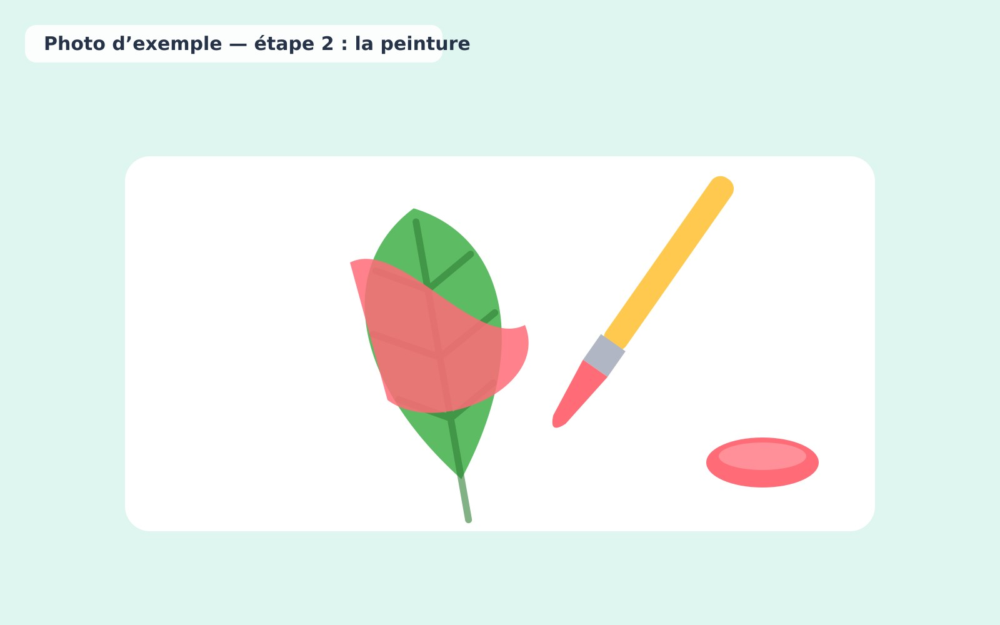
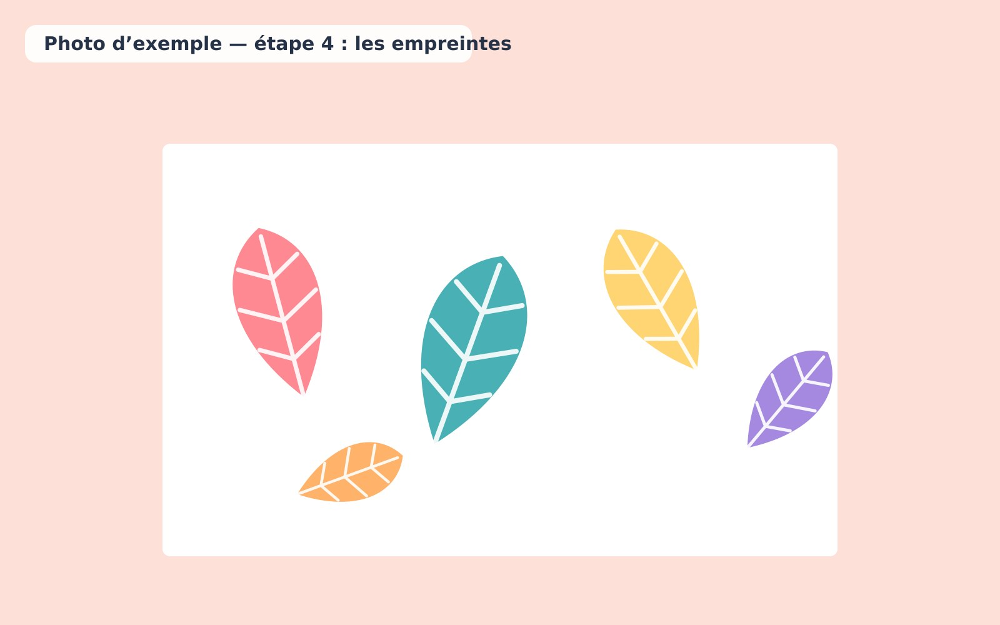

1. Observer les nervures et les contours des feuilles.
2. Étaler une fine couche de peinture sur une feuille.

   

3. Presser doucement la feuille sur une feuille de papier.
4. Soulever et comparer les empreintes.

   

5. Composer une grande fresque collective.
