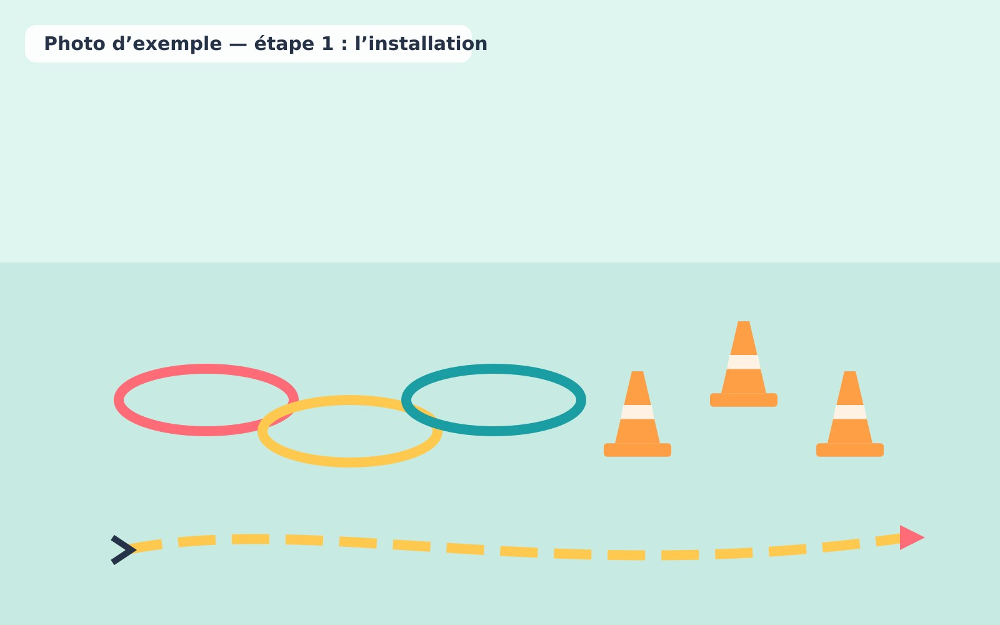
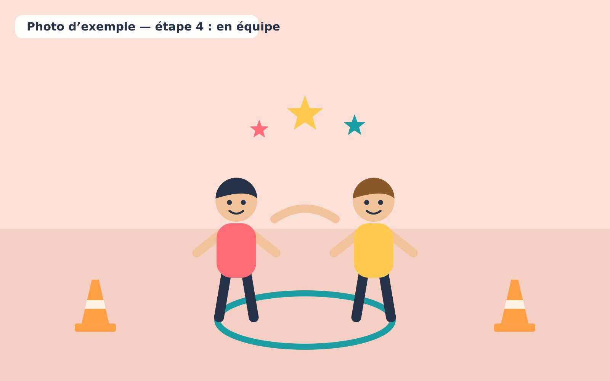

1. Installer un parcours simple avec trois ou quatre étapes.

   

2. Montrer comment franchir chaque étape.
3. Laisser les enfants essayer à leur rythme.
4. Proposer un deuxième passage en équipe.

   

5. Inviter les enfants à inventer une variante sécuritaire.
