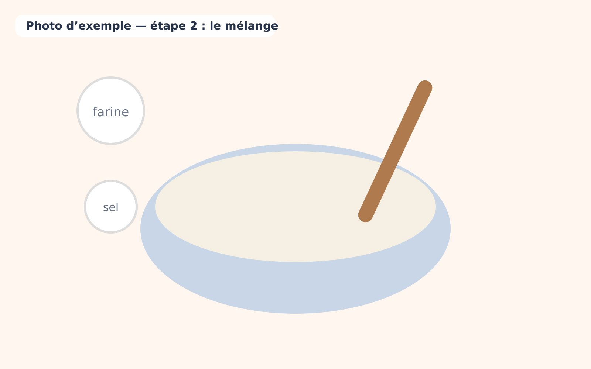
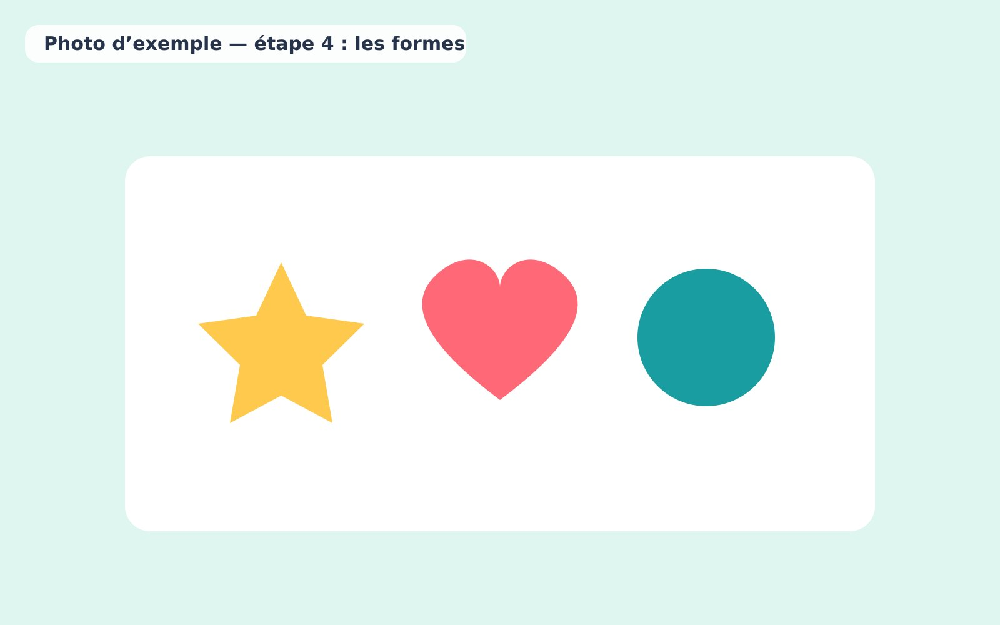

1. Montrer les ingrédients aux enfants et les laisser toucher la farine et le sel.

2. Verser la farine et le sel dans le grand bol, puis mélanger avec une cuillère en bois.

   

3. Ajouter l'eau petit à petit et pétrir jusqu'à obtenir une boule souple. Séparer la pâte en plusieurs boules et ajouter quelques gouttes de colorant dans chacune.

4. Aplatir la pâte et découper des formes avec les emporte-pièces, ou modeler librement.

   

5. Laisser sécher les créations 24 à 48 heures à l'air libre avant de les exposer.
