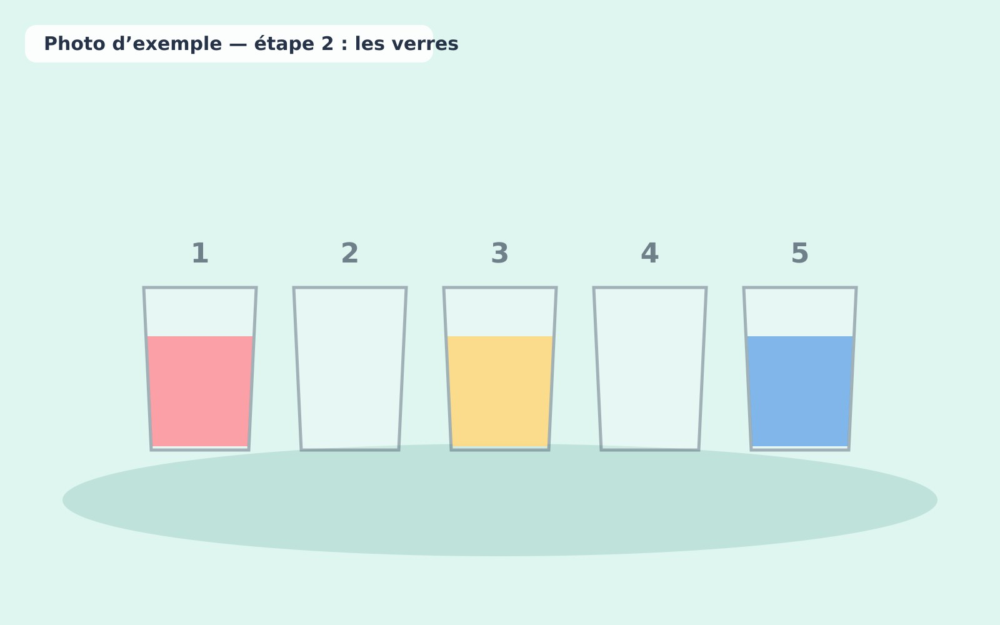
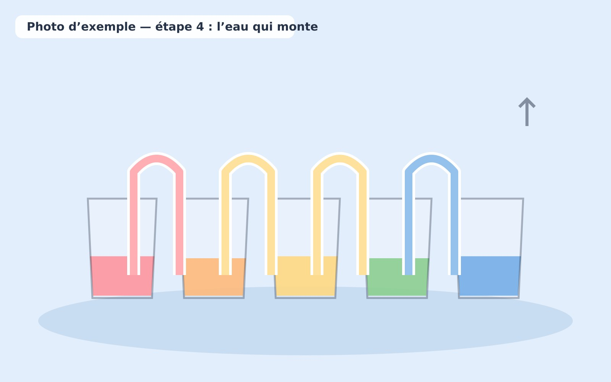

1. Aligner cinq verres transparents sur une table protégée.
2. Remplir les verres 1, 3 et 5 d'eau colorée.

   

3. Plier des bandes d'essuie-tout et relier les verres voisins.
4. Observer le déplacement de l'eau au fil du temps.

   

5. Demander aux enfants de décrire les nouvelles couleurs.

**Variante :** Photographier l'expérience à intervalles réguliers pour comparer les observations.
