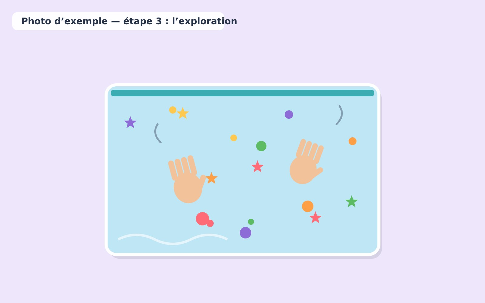

1. Installer l'enfant confortablement avec un adulte à proximité immédiate.
2. Présenter une pochette intacte adaptée à son âge.

   

3. Laisser l'enfant explorer doucement avec les mains.

   

4. Nommer les couleurs et décrire les mouvements observés.
5. Terminer dès que l'enfant montre des signes de fatigue ou de désintérêt.
