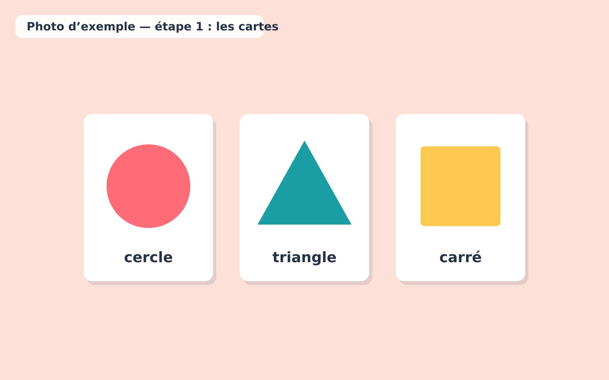
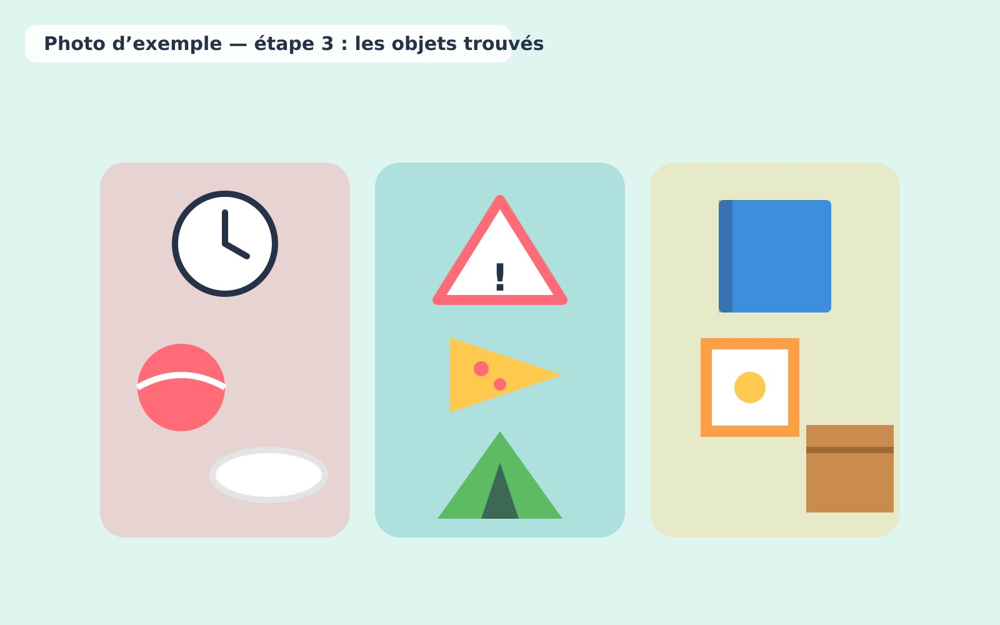

1. Montrer un cercle, un triangle et un carré.

   

2. Demander aux enfants de repérer ces formes autour d'eux.
3. Comparer les objets trouvés.

   

4. Compter les découvertes de chaque catégorie.
5. Pour les plus grands, chercher des formes plus complexes.
