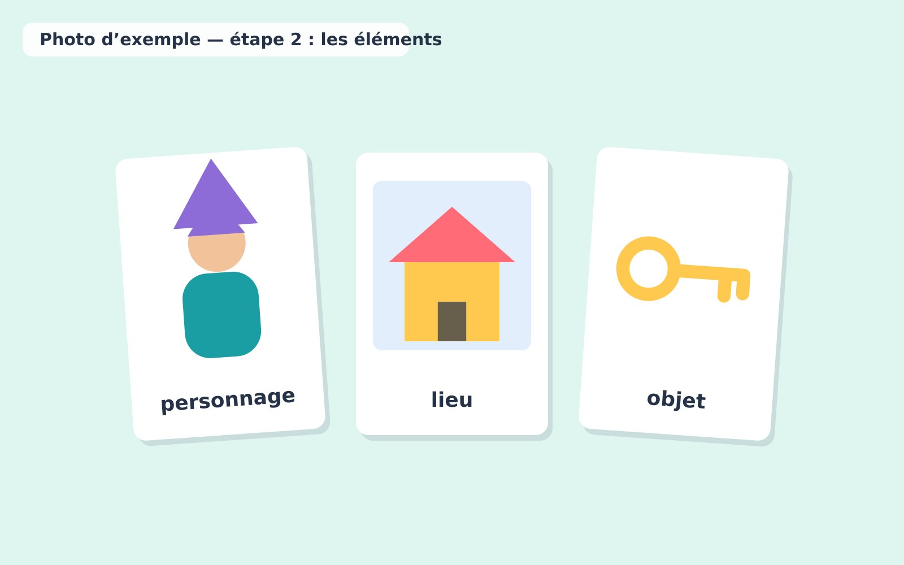
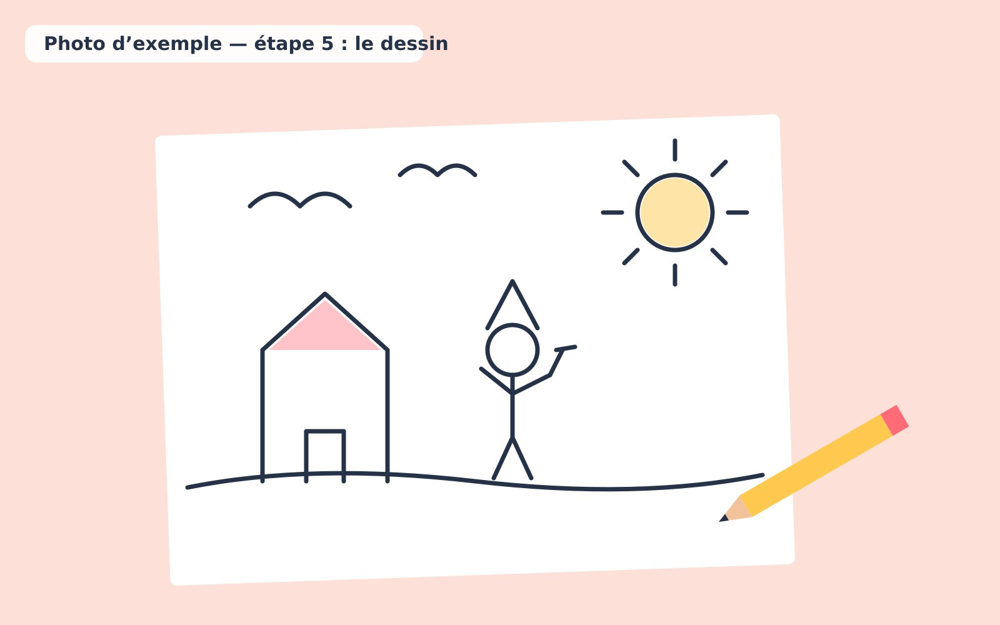

1. Distribuer quelques cartes illustrées ou lancer les dés.
2. Choisir un personnage, un lieu et un objet.

   

3. Commencer une histoire avec ces trois éléments.
4. À tour de rôle, chaque enfant ajoute une phrase.
5. Dessiner la scène préférée de l'histoire.

   
